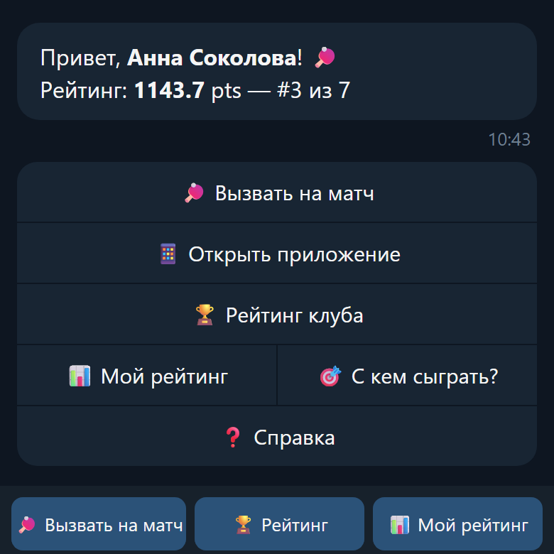
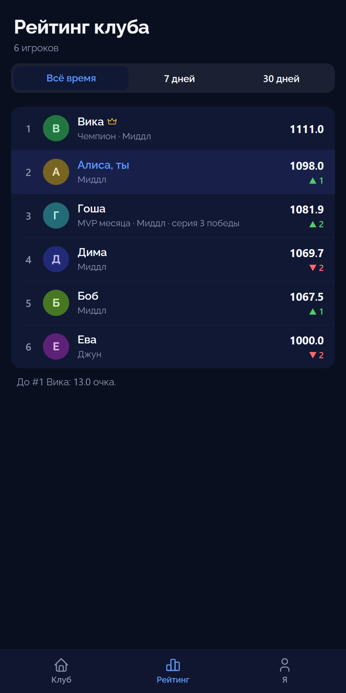
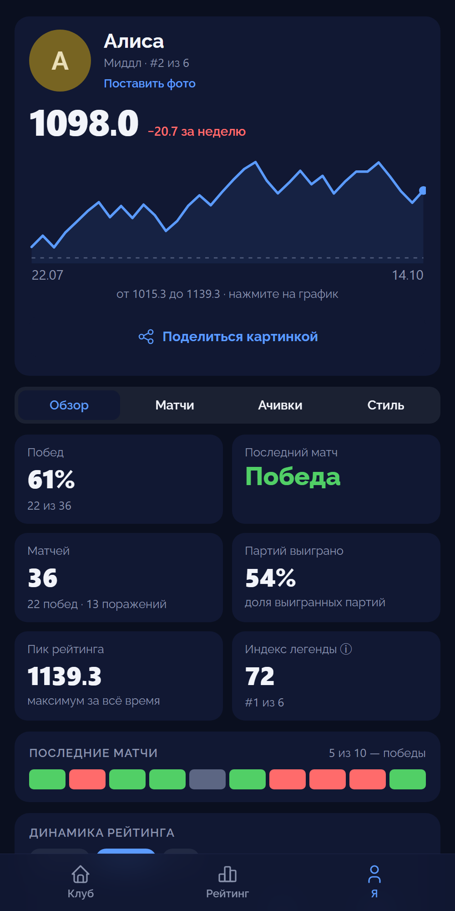
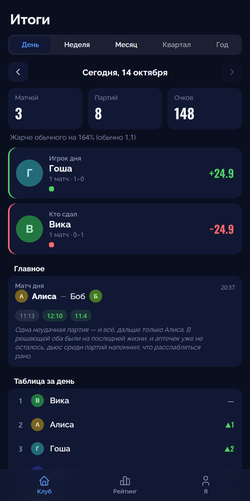
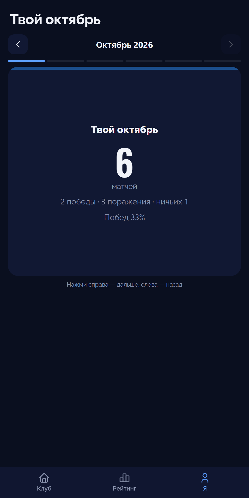
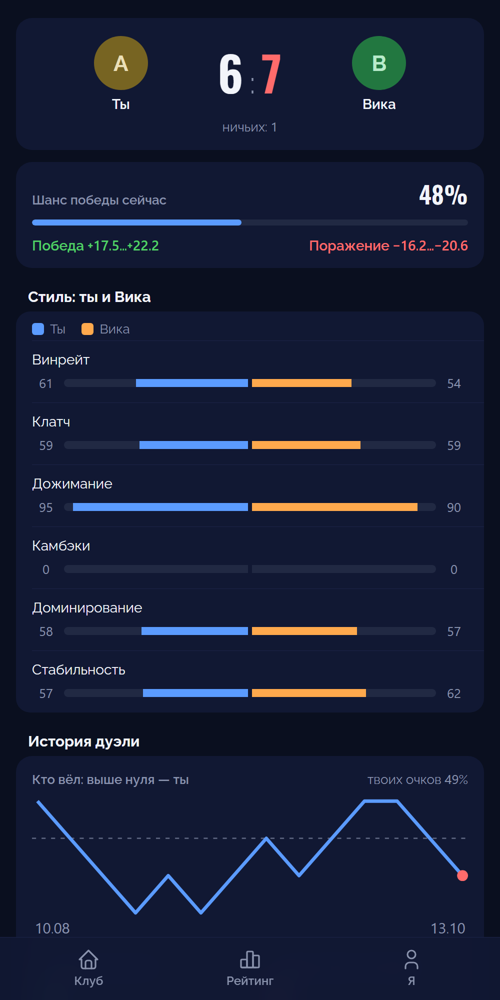
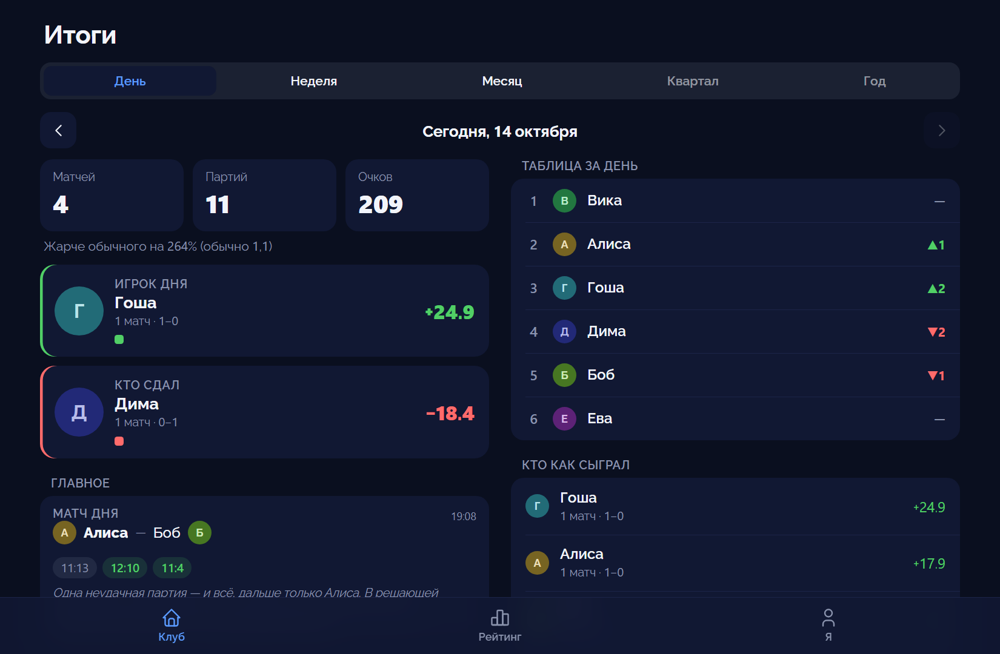

# 🏓 bottennis


> Telegram-бот для рейтинговых игр в настольный теннис внутри команды.
> Реальный проект в проде: регистрация, вызовы, рейтинг ELO, статистика, ачивки, авто-сводки и Mini App клуба.
>
> *A production Telegram bot + Mini App for office table-tennis rankings — ELO ratings, stats, achievements, digests, club feed. Built and tested end-to-end.*

---

<p align="center">
  
  
  
</p>
<p align="center">
  
  
  
</p>
<p align="center">
  
</p>

> Скриншоты обезличены: главный экран бота — макет с вымышленным именем, экраны Mini App сняты с превью на временной базе с вымышленными игроками (`scripts/preview_miniapp.py`).

---

## 🎯 Об этом проекте

В офисе стоит теннисный стол, и в перерывах мы рубимся не на жизнь, а на рейтинг. В какой-то момент захотелось не просто играть, а вести честный ELO, считать серии побед и каждый вечер выбирать «матч дня». Так в нерабочее время и родился этот бот.

Это **не учебный todo-лист, а живой бот в проде**: я спроектировал, написал и **покрыл тестами** весь цикл — от регистрации по инвайту до пересчёта рейтинга и вечерних сводок. Каждую фичу сопровождал автотестами — сейчас их **1722** (включая тесты хендлеров на сам флоу), плюс CI на каждый push и привычка проверять граничные случаи. Регрессии отлавливаются раньше, чем долетают до игроков — и быстрее, чем я успеваю проиграть очередную партию.

Кстати о матчах: бот работает безупречно — чего не скажешь о моей игре. Я стабильно болтаюсь в нижней половине собственного лидерборда. Зато тесты зелёные. 🏓

## ✅ Тестирование (главное)

```bash
pytest -v          # 1722 автотеста, ~7 секунд
```

- **1722 автотеста** на `pytest` + `pytest-asyncio` (юнит чистой логики + тесты хендлеров)
- **Property-based тесты** (`hypothesis`) — вместо нескольких придуманных примеров проверяются правила, которые должны держаться для любых входов: формула рейтинга, валидация счёта, звания, склонение, окно голосования. В CI примеры фиксированы (воспроизводимый прогон), локально случайные. Памятка: [`docs/PROPERTY_TESTS.md`](docs/PROPERTY_TESTS.md)
- **CI на GitHub Actions** — тесты прогоняются на каждый push и PR (бейдж выше)
- **Тесты Mini App в настоящем браузере** (Playwright): каждый экран в светлой и тёмной теме, на телефоне и компьютере — без ошибок JS и неудачных запросов; основные действия (реакция, фильтр, сторис, свайп, «Поделиться»); плюс скриншот-тесты с эталонами. Логика страницы — отдельные тесты в Node
- Чистое разделение: бизнес-логика вынесена в чистые функции и покрыта unit-тестами без БД и сети
- Подробнее о стратегии — в [`TESTING.md`](TESTING.md)

**Что покрыто:**

| Модуль | Файл тестов | Что проверяется |
|---|---|---|
| Рейтинг ELO | `tests/test_rating.py` | дельта, апсеты, разгром vs упорный матч, штраф за 1 партию, симметрия вероятности победы |
| Валидация счёта | `tests/test_validation.py` | правила настольного тенниса: ≥11 с отрывом ≥2, дьюс, некорректные счета |
| **Property-тесты** | `tests/test_properties.py` | инварианты для любых входов: монотонность дельты по силе соперника, зеркальность ничьей, границы валидации, звания, ось графика, окно голосования |
| **Пинги рекордов клуба** | `tests/test_club_record_pings.py` | пороги редких рекордов, тексты, антиспам (кулдаун 7 дней), интеграция с внесением результата |
| Достижения | `tests/test_achievements.py` | все 69 ачивок, идемпотентность, бэкфилл по истории (in-memory SQLite) |
| «Матч дня» | `tests/test_match_of_day.py` | индекс драмы, выбор матча, перспектива счёта |
| Личные встречи | `tests/test_h2h.py` | H2H-счёт, подсчёт партий с перспективы игрока, серии |
| **Хендлеры (флоу)** | `tests/test_handlers.py` | вызов, прямой ввод счёта, валидация, отмена матча — с моками Telegram и реальными FSM + БД |
| **График рейтинга** | `tests/test_rating_chart.py` | построение серии рейтинга, URL графика, граничные случаи |
| **Планировщик (таймзона)** | `tests/test_scheduler_timezone.py` | cron-задачи срабатывают в нужный момент по МСК независимо от таймзоны сервера |
| **Хелперы дайджестов** | `tests/test_digest_helpers.py` | «Американские горки», «Без поражений», суммарные очки — чистые функции без БД |
| **Босс-файт за 1-е место** | `tests/test_boss_fight.py` | ранги, претендент и порог матчей, механика матча, блокировка реванша, авто-освобождение трона |

**Примеры пойманных и исправленных багов** (см. `RELEASE_NOTES.md`):
- Краш при вводе счёта, если у игрока 2+ активных матча (`MultipleResultsFound`)
- Некорректная дельта при срабатывании «пола» рейтинга
- Неверная перспектива счёта при инверсии победителя
- Сброс ввода при наборе счёта на экране подтверждения

## 🤖 Что умеет бот

- ⚔️ **Босс-файт за 1-е место** — место #1 занимается не по очкам, только победой над чемпионом
- 🏅 **69 достижений** (31 скрытых) + **7 личных рекордов** + пасхалки после матчей
- 📅 **5 уровней автосводок** — день / неделя / месяц / квартал / год, каждая персонализирована
- 📊 **Честный ELO** — ничьи, «пол» рейтинга, штраф за повтор соперника, график динамики
- 🎖 **Звания, зал славы, карточка победы** — косметика поверх рейтинга и трона

<details>
<summary><h3>📋 Полный список фич (нажми, чтобы развернуть)</h3></summary>

### Матчи и рейтинг
- Регистрация по инвайт-ссылке (`/start <CODE>`)
- Вызов соперника — матч становится активным сразу
- Внесение результата пошаговым FSM или **прямым вводом счёта** в чат (`11:7 9:11 11:5`)
- Кнопка «Реванш» сразу после матча у обоих участников (в уведомлении о результате и на экране внёсшего счёт)
- **Валидация счёта** по правилам настольного тенниса (≥11 очков с отрывом ≥2, дьюс 12:10, 13:11…)
- Поддержка **ничьих** (при равном счёте по партиям — ELO-пересчёт в обе стороны)
- Автоматический пересчёт рейтинга (ELO с бонусами за доминирование)
- **Только один активный матч одновременно** — нельзя вызвать нового соперника, пока не завершён текущий; ⏰ напоминание через 24 часа, если матч завис
- **Прогноз перед матчем** — шансы на победу по ELO + мемная фраза под расклад (фаворит / равны / андердог)
- 📊 **График динамики рейтинга** — линия рейтинга по матчам через quickchart.io (для себя и для любого игрока из его профиля)
- 🔥 **Тепловая карта активности** — сетка за 90 дней в стиле GitHub-контрибуций, личная/клубная версия переключаются одной кнопкой

### Статистика и профиль
- Таблица рейтинга с ▲▼ изменением позиции за неделю, винрейтом, сериями
- **Подробная** личная статистика (форма за неделю, серии, любимый соперник), профиль игрока, **личные встречи (H2H)** с локальной пометкой «⚖️ Равный бой» при сбалансированном счёте (≥4 матча, разница побед ≤1)
- **Расширенная статистика/профиль** — тренд за 30 дней, партии на дьюсе, разрыв до соседа по таблице, дистанция до трона (боссфайт). Экран в два уровня: короткая главная (форма, индекс легенды, цель) и разделы на кнопках — «С кем играю», «Рейтинг в цифрах», «Привычки и советы»
- **Прогресс до ачивки** — в личной статистике одна строка с ближайшей незаработанной целью + текстовый прогресс-бар
- **Умные советы** — счастливый день недели, как играешь после поражений, любимый счёт партии, спринтер или марафонец
- **Карьер-рекап** — по кнопке «Моя история» на «Статистике», доступен в любой момент
- **Мгновенные вехи** — разовый пинг на круглых цифрах (каждые 100 матчей, каждые 500 очков за карьеру)
- **Звания по рейтингу** (Джун/Миддл/Сеньор/Тим лид/Ген дир) — рядом с рейтингом в статистике и профиле
- **Экран «С кем сыграть?»** — активные матчи клуба + рекомендации соперника с сигналом (серия поражений, реванш, пауза, сильный соперник)
- **Экран «Сегодня в клубе»** — счёт дня по всем игрокам, личный мини-итог зрителя (его счёт и дельта за день) и список всех матчей дня со счётами
- **Радар личного стиля** — кнопка «Стиль» на «Статистике» и на профиле любого игрока, 6 осей (винрейт, клатч, дожимание, камбэки, доминирование, стабильность) через quickchart, с архетипом («Финишер», «Каток», «Феникс»…) и расшифровкой осей
- **Сравнение стилей** — кнопка на экране личных встреч: два радара на одном графике, кто по каким осям сильнее
- **Незакрытые долги** — соперники, чей самый недавний матч против тебя закончился твоим поражением без реванша
- **У тебя в долгу** — зеркало «Незакрытых долгов»: соперники, которым сам последний раз проиграл
- **Стрик активности** — сколько дней подряд играешь, отдельно от серии побед
- **MVP месяца** 🌟 — бейдж по наибольшему приросту рейтинга с начала месяца, автоматически, без голосования
- **Калькулятор «Что если»** — кнопка на профиле соперника, диапазон ориентировочной дельты рейтинга без начала матча
- **Индекс легенды** — композитный балл декорированности карьеры (ачивки, личные рекорды, боссфайты, серии, трон) + позиция в клубе, на личной статистике и публичном профиле

### Достижения и рекорды
- **Босс-файт за 1-е место** — ×2 к рейтингу, ничья запрещена, блокировка мгновенного реванша. Если статус претендента пропадает раньше боссфайта — «💸 ПОТРАЧЕНО» и скрытая ачивка «Просран шанс»
- **«Трон трещит»** — приватное уведомление чемпиону, если кто-то подбирается к нему снизу ближе чем на 20 очков
- Система достижений (69 ачивок, 31 из них скрыты до разблокировки, сгруппированы по категориям) и пасхалки после матчей
- **Личные рекорды** — 7 метрик (серия побед, серия без поражений, побед за день, разгром по очкам, самый долгий матч, больше всего очков за матч, серия над одним соперником), сравнение только с собственной историей игрока, не с другими
- **Рекорды клуба** — четыре раздела на кнопках (объёмы, противостояния, серии, топ-моменты); все рекорды за всё время: серии (лучшая и текущая активная), высший рейтинг в истории, дольше всех лидировал на 1-м месте, самое короткое правление, больше всего восхождений на трон, больше всего защит трона подряд, длинные и самые быстрые матчи, самый долгий боссфайт, апсеты, эпичные матчи, дерби клуба (самая играющая пара), нагибатор клуба (самое одностороннее противостояние), равный бой (самое сбалансированное противостояние), долгожданная месть, железные нервы (наименьший разброс рейтинга за карьеру), больше всего ничьих, самый жаркий день клуба, золотой час клуба (когда играют чаще всего)
- **Пинги «Рекорд клуба»** — сообщение всем игрокам сразу после матча, но только когда побит один из четырёх по-настоящему редких рекордов (пик рейтинга клуба, серия побед, защиты трона, крупнейший апсет); пороги подобраны по истории матчей, один игрок по одному рекорду — не чаще раза в 7 дней
- **Рейтинг клуба в итоге матча** — все места списком прямо в сообщении о результате: свой ряд, чемпион, «(было #N)» при смене места и разрыв до игрока выше; рядом с «В меню» стоит кнопка соседнего экрана, чтобы не заходить в меню лишний раз (сделано по данным `/usage` о реальных переходах)
- **До следующего звания** — строка на экране «Мой профиль»: сколько рейтинга не хватает до следующего IT-звания
- **Матрица доминирования** — таблица взаимных счётов всех игроков (топ-8 по рейтингу)
- **Зал славы** — полная история правлений на месте #1
- **Карточка «поделиться победой»** — текстовая карточка со счётом и репортажем матча, доступна реальному победителю сразу после матча

### Автосводки и прочее
- 📅 Итоги дня в 21:30 МСК — топ дня с полоской формы, «матч дня», нагибатель дня, «дуэль дня» (самая частая пара + счёт между ними), лучший и отрицательный рост, «американские горки» (волатильность рейтинга), «без поражений», суммарные очки, пометка рекорда клуба по матчам за день
- 📊 Еженедельный и ежемесячный дайджесты — личная шапка (счёт, рейтинг, прогресс до ачивки) + общий клубный блок с той же полоской формы, «халявщиком», «без поражений», «американскими горками», что и в итогах дня; недельная сводка сравнивает матчи, партии и очки со средним за 4 недели, месячная — с прошлым месяцем (плюс личное сравнение «ты против прошлого месяца» и ачивки месяца)
- **Итоги квартала** (1-го числа января/апреля/июля/октября, 10:30 МСК) — самая насыщенная периодическая сводка, с сравнением с прошлым кварталом
- **Итоги года** (30 декабря, 12:00 МСК) — полный табель клуба, чемпион года, взлёт/падение, дерби, топ-матч года
- **Голосование «Итоги года: неформальные звания»** — раз в год (21-30 декабря), 6 номинаций (Джентльмен года, Отмазка года, Комментатор года, Самый орущий у стола, Все хотят посамбоваться, С кем сложнее всего), голосуют игроки с ≥1 матчем в этом году, анонимно, результаты сразу после «Итогов года»
- **Индекс формы** — отдельный рейтинг по последним 10 матчам каждого игрока, не по всей карьере
- **Репортаж матча** — расширенный связный абзац вместо короткой фразы для топ-матча каждого периода
- Постоянная клавиатура быстрого доступа снизу (Вызвать на матч / Рейтинг / Мой рейтинг)
- **Тихий режим** — экран «Рассылки» под `/help`: игрок отключает отдельные автосводки (итоги дня, недели, месяца, квартала, года); личные уведомления и голосование отключить нельзя
- `/feedback` — отправить идею или баг напрямую разработчику, минуя общий чат
- `/name` — сменить имя в боте; справка по рейтингу и команда доступны по кнопке «Справка» в меню
- **Mini App клуба** — свой интерфейс внутри Telegram поверх тех же данных (кнопка меню «Клуб» и кнопки в боте открывают нужный экран сразу):
  - главная: подиум — советская тумба с цифрами 2, 1, 3, «Ты сегодня», меню клуба плиткой (частые экраны сверху по тому, что клуб реально открывает, остальное — под «Ещё»), матч дня, **лента клуба** карточками за 30 дней (матчи, ачивки, рекорды, смена трона; репортаж — у самого яркого матча дня), «Показать ещё», подсказка при первом запуске;
  - **итоги** дня, недели, месяца, квартала и года с анимацией — бот присылает в чат начало сводки и кнопку на этот экран; на вкладке «Год» — «Твой год» и неформальные звания (голосование остаётся в боте);
  - рейтинг за всё время, 7 и 30 дней; профиль-табло, график рейтинга по датам со сравнением с любым игроком; ачивки сеткой с уровнями, редкостью, датами и тремя ближайшими; новые ачивки подсвечиваются один раз;
  - **экран матча** (партии полосками, изменение рейтинга, личные встречи) и **реакции** на матчи (огонь, класс, смешно, какашка; одна на игрока) с именами поставивших — без единого уведомления; самый обсуждаемый матч попадает в итоги дня;
  - своё фото в профиле: игрок присылает его боту (`/photo` или ссылка «Поставить фото» в приложении) — для тех, у кого аватар в Telegram скрыт настройками приватности;
  - **итоги дня** на отдельном экране и за любой прошедший день (стрелки «вчера/позавчера»): табло и сравнение с обычным днём, игрок дня и «кто сдал», движение в таблице, матч дня и «матч, который обсуждали», матчи по часам, ачивки и рекорды дня;
  - «Против каждого» в профиле и фильтр истории по сопернику и периоду; реакции и на ачивки с рекордами в ленте;
  - «Поделиться картинкой»: карточка итогов дня или своего профиля приходит в чат с ботом, оттуда её можно переслать;
  - на компьютере (широкое окно Telegram) главная, профиль и итоги дня — в две колонки;
  - свой характер: цифры как на табло, карточка игрока с полосой стола и шестью характеристиками стиля, рисунок мяча и ракетки на пустых экранах, штамп «Камбэк»/«Разгром»/«Дьюсы»/«Боссфайт» на ярких матчах;
  - «Твой месяц» — история месяца карточками, как сторис; личные рекорды, коронный счёт и главный соперник в профиле; шанс на победу прямо в чужом профиле;
  - история дуэли на «Ты против …» (кто вёл по ходу встреч, лучшие серии, лучший матч пары), летопись клуба и счета клуба (частые счета партий, дьюсы);
  - **жесты**: свайп между разделами профиля, «потяни вниз — обновить» (мяч дважды отскакивает от стола и улетает вверх), «назад» свайпом от левого края, долгое нажатие на игрока — быстрое меню «Вызвать на матч / Ты против … / Профиль» (на компьютере — правая кнопка), нажатие на активную вкладку наверху — обновить;
  - **сравнение любой пары** «A против B» — из чужого профиля, «Кто с кем» и экрана матча; серия игровых дней в профиле (выходные не рвут);
  - **«Рекорды клуба» витриной**: главный рекорд золотой карточкой, «Под угрозой» — кто догоняет рекорд (с полоской), плитки рекордов с метками «новый», «Рекордсмены»;
  - «Когда играют» (день недели × час), рекорды, история, зал славы, «ты против …»; для администратора — «Использование» (счётчик экранов бота и приложения);
  - **«Вызвать на матч»** прямо из приложения (главная, профиль соперника, «Ты против …»): бот присылает экран вызова в чат, приложение закрывается — сам вызов по-прежнему в боте;
  - **«Пока тебя не было»** — что изменилось с прошлого захода (место, рейтинг, матчи, ачивки, чемпион) и **«Цели недели»** — три личные цели с кольцами прогресса и счётчиком закрытых недель (закрытая цель празднуется мячиками, вся неделя — конфетти) (цель на мастерство своя у каждого, из восьми, с упором на слабую сторону); иконка клуба на экране телефона;
  - **цвет показателей стиля** относительно клуба (серый — мало данных, зелёный — сильная сторона, золото — лучший в клубе, красный — слабое место);
  - **«Кто с кем»** (матрица пар клуба), **«Гонка рейтинга»** за 30 дней, рейтинг за 7, 30 и 90 дней, мини-графики в таблице рейтинга;
  - живой дизайн: переходы по направлению, «переезд» строк рейтинга, конфетти новой ачивки, заставка нового звания, рамки карточек тройки лидеров, цифры-табло, подиум, экран матча «партия за партией», штамп характера матча у победителя, картинка на заставке и в «С возвращением!»;
  - **«Зал славы»**: чемпион на троне (картинка владельца) со свечением и искрами, живой таймер правления, претендент на боссфайт или ближайший к трону, летопись трона, анимация смены чемпиона; при «уменьшить движение» — без анимаций;
  - **во весь экран**: на телефоне всё приложение сразу, на компьютере — кнопкой в углу (выбор запоминается);
  - быстрый запуск: скрипт Telegram со своего сервера (не зависит от telegram.org), мгновенный старт из снимка главной, облегчённый шрифт, бюджет загрузки в CI (первый запуск ≤ 180 КБ, сейчас ~170 вместе с картинкой заставки; строки-комментарии из app.js при раздаче убираются); на большом клубе профиль и рекорды отвечают из памяти (кэш по версии данных клуба с прогревом в фоне), длинные списки матчей — порциями по 40;
  - автообновление при возврате в приложение, переходы, скелеты загрузки, значки Tabler Icons, светлая и тёмная темы; закрытие случайным свайпом отключено. Скорость: статика и ответы сжаты gzip, файлы с версией кэшируются навсегда, первый экран грузится без лишнего ожидания, вкладки «Рейтинг» и «Я» подгружаются заранее (первый запуск ~34 КБ вместо ~139). Устройство и включение: [`docs/MINIAPP.md`](docs/MINIAPP.md)

</details>

## 🧭 Принципы

- **Без вовлекающих уловок.** Стол стоит в офисе — бот помогает вести счёт, а не подсаживает на игру. Никаких «ты сегодня не играл!», стриков-крючков и навязчивых пушей.
- **Честный рейтинг.** Поддержаны ничьи (ELO корректно считает обе стороны), есть «пол» рейтинга, штрафы за повтор соперника и однопартийные матчи.
- **Подробная статистика важнее геймификации:** форма за неделю, серии, H2H, личные рекорды.

## ⭐ Рейтинговая система

Модифицированный **ELO** с бонусами за доминирование в партиях:

```
E          = win_probability(winner, loser) = 1 / (1 + 10 ^ ((loser - winner) / 400))
base_delta = 32 * (1 - E)

score_mult       = 1 + 0.5*(sets_ratio - 0.5) + 0.3*(pts_ratio - 0.5)
short_match_mult = 0.75 если матч из 1 партии
newcomer_bonus   = 1.2 если у победителя < 15 матчей
repeat_mult      = max(0.5, 1.0 - 0.05 × streak)   # штраф за серию побед над тем же соперником

delta = base_delta × score_mult × short_match_mult × newcomer_bonus × repeat_mult
```

Подробный анализ формулы на реальных данных — в [`RATING_ANALYSIS.md`](RATING_ANALYSIS.md).

## 🧱 Стек

| Слой | Технология |
|---|---|
| Язык | Python 3.13 |
| Telegram | aiogram 3.x (long-polling) |
| ORM | SQLAlchemy 2.x (async) |
| БД | SQLite + aiosqlite |
| Фоновые задачи | APScheduler 3.x |
| Mini App | aiohttp (в процессе бота), HTML/CSS/JS без сборки, Caddy (HTTPS) |
| Тесты | pytest, pytest-asyncio, hypothesis |
| Линтер | ruff |
| CI | GitHub Actions (lint + тесты на 3.13) |
| Хостинг | VPS (FirstVDS, Ubuntu 24.04) |

## 📁 Структура

```
bottennis/
├── main.py                     # точка входа: Bot, Dispatcher, роутеры, планировщик
├── bot/
│   ├── handlers/
│   │   ├── start.py            # /start, /help, навигация
│   │   ├── leaderboard.py      # таблица рейтинга, «сегодня»
│   │   ├── profile.py          # статистика, профиль, достижения
│   │   ├── history.py          # история матчей, личные встречи (H2H)
│   │   ├── challenge.py        # вызов, отмена матча
│   │   ├── match_result.py     # FSM ввода результата
│   │   └── admin.py            # админ-команды (/dbstats, /backup, /usage)
│   ├── services/
│   │   ├── rating.py           # формула ELO
│   │   ├── validation.py       # валидация счёта
│   │   ├── achievements.py     # система достижений
│   │   ├── stats.py            # статистика игрока (общая для профиля и дайджеста)
│   │   ├── personal_records.py # личные рекорды игрока
│   │   ├── club_records.py     # пинги редких рекордов клуба
│   │   └── leaderboard.py      # данные таблицы рейтинга (бот и Mini App)
│   ├── keyboards/inline.py     # все inline-клавиатуры
│   ├── db/                     # models.py, database.py
│   ├── scheduler.py            # итоги дня, дайджест, offsite-бэкап
│   ├── middleware.py           # сессия БД на каждый апдейт
│   ├── states/states.py        # FSM-состояния
│   ├── webapp/                 # Mini App: вход по initData, API экранов, лента/итоги/реакции, веб-сервер aiohttp
│   └── utils.py                # хелперы + чистая логика (H2H, «матч дня»)
├── webapp/src/app/            # исходник страницы Mini App частями по экранам (склеивает scripts/build_app_js.py)
├── webapp/static/             # страница Mini App (HTML/CSS/JS без сборки, набор значков icons.svg)
├── tests/                      # 1722 автотеста (юнит + хендлеры)
└── scripts/                    # разовые скрипты: миграции, анализ рейтинга, превью Mini App, выгрузка счётчика
```

## 🚀 Запуск у себя

Бот легко развернуть со своим токеном и своей базой:

```bash
git clone https://github.com/petershor99-qa/bottennis.git
cd bottennis

python -m venv .venv && source .venv/bin/activate   # Windows: .venv\Scripts\activate
pip install -r requirements.txt

cp .env.example .env        # впиши свой BOT_TOKEN от @BotFather
python main.py
```

Деплой на VPS — автоматический через GitHub Actions: мерж PR `develop→main` запускает `git pull` + `systemctl restart bottennis` по SSH, затем job проверяет `systemctl is-active bottennis` и падает (с логом `journalctl`), если сервис не поднялся. БД хранится в `/data/bottennis.db`.

### systemd-юнит на VPS

Эталонное содержимое `/etc/systemd/system/bottennis.service` — с `Restart=on-failure`, чтобы бот сам поднимался при падении между деплоями:

```ini
[Unit]
Description=bottennis Telegram bot
After=network.target

[Service]
Type=simple
WorkingDirectory=/opt/bottennis
ExecStart=/opt/bottennis/.venv/bin/python main.py
Restart=on-failure
RestartSec=5
EnvironmentFile=/opt/bottennis/.env

[Install]
WantedBy=multi-user.target
```

> ℹ️ **Достижения и пасхалки** — внутренние шутки нашей команды, **местами с нецензурной лексикой**. Все тексты собраны в `bot/services/achievements.py` и `bot/handlers/match_result.py` — легко заменить под свою компанию.

### Переменные окружения

| Переменная | Описание |
|---|---|
| `BOT_TOKEN` | токен от @BotFather |
| `INVITE_CODE` | код для пригласительной ссылки (пусто → регистрация открыта) |
| `ADMIN_ID` | Telegram ID администратора (для `/dbstats`, `/fix_rating`, `/usage`) |
| `DATABASE_URL` | напр. `sqlite+aiosqlite:////data/bottennis.db` |
| `WEBAPP_URL` | HTTPS-адрес Mini App; пусто — приложение выключено (см. `docs/MINIAPP.md`) |
| `WEBAPP_AUDIENCE` | `admin` (по умолчанию, только администратор) или `all` |

### Бот без Mini App

Приложение необязательно. Если `WEBAPP_URL` в `.env` не задан, веб-сервер не стартует, кнопок приложения нет, а бот работает в **полном режиме**: все экраны статистики (профиль, история, личные встречи, радар, ачивки, рекорды, зал славы и др.) открываются прямо в чате. С `WEBAPP_URL` бот становится **коротким** для тех, кому приложение доступно (`WEBAPP_AUDIENCE`): в чате остаются вызов и запись матча, рейтинг, «Мой рейтинг», голосование и уведомления, а подробная статистика открывается в приложении. Код полного режима не удаляется — переключение только через `.env`. Устройство приложения и включение — [`docs/MINIAPP.md`](docs/MINIAPP.md).

## 📜 История изменений

Подробный changelog — в [`RELEASE_NOTES.md`](RELEASE_NOTES.md).

## 📄 Лицензия

[MIT](LICENSE) © Peter Shor
